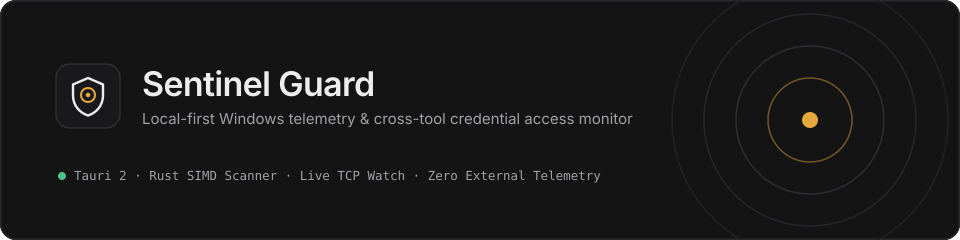
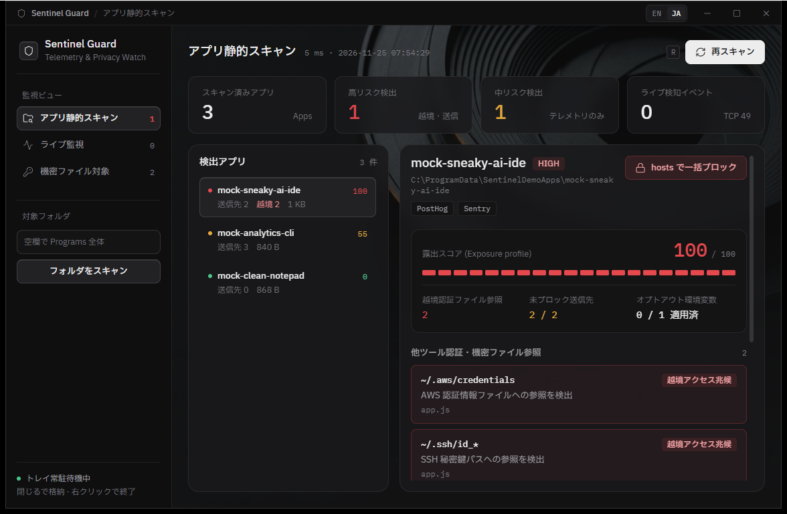

<div align="center">



<h1>Sentinel Guard</h1>

<p><strong>Windows 向けローカル完結型テレメトリ＆他ツール認証ファイル越境アクセス監視アプリ</strong></p>

<p>
  <a href="https://github.com/Sunwood-ai-labs/sentinel-guard/actions/workflows/ci.yml"></a>
  <a href="https://sunwood-ai-labs.github.io/sentinel-guard/ja/"></a>
  <a href="LICENSE"></a>
  
  
</p>

<p>
  <a href="README.md">English</a> · <strong>日本語</strong> · <a href="https://sunwood-ai-labs.github.io/sentinel-guard/ja/">ドキュメント</a>
</p>

</div>

---

## ✨ 概要

<p align="center">
  
</p>

**Sentinel Guard** は、**Tauri 2 + Rust + React** で構築された軽量な Windows デスクトップ監視アプリです。インストール済みの Electron アプリや開発ツールを解析し、以下を可視化・遮断します。

- **隠れテレメトリ送信先**（PostHog / Axiom OTLP / Sentry / Segment / Mixpanel / Amplitude / Datadog / `ingest.*` / `telemetry.*` 等）
- **他ツール認証ファイルへの越境アクセス兆候**（`~/.codex/auth.json`, `~/.claude.json`, `~/.aws/credentials`, `~/.ssh/id_*` 等を別アプリが参照しているケース）
- **コード内に隠されたオプトアウト環境変数**（`*_TELEMETRY_ENABLED`, `*_OTEL_SDK_DISABLED`, `DO_NOT_TRACK` 等）
- **アクティブな外部テレメトリ通信**（標準ユーザー権限のままプロセス名・PID 単位でリアルタイム照合）

フォント（`IBM Plex Sans JP` / `IBM Plex Mono`）や背景素材はすべてアプリ内にローカルバンドルしており、Sentinel Guard 自身は **外部 CDN 通信やテレメトリ送信を一切行いません**。

## 🔍 主な機能

- **Rust 高速静的スキャナー**: SIMD リテラルアンカー検索（`regex::bytes`）により、275 MB 級の `.asar` バンドルを約 0.4 秒で走査します。`%LOCALAPPDATA%\Programs` 全体または任意フォルダをスキャン可能。
- **Exposure Profile 計器 UI**: 各アプリのリスクスコア（`0–100`）を 20 セグメント計器バーと 3 軸内訳（越境認証参照 / 未ブロック送信先 / オプトアウト適用率）で一目で把握できます。
- **ライブ通信監視**: `Get-NetTCPConnection` の確立済み HTTPS / OTLP 接続と既知テレメトリ IP マップをリアルタイム照合し、Windows DNS キャッシュ履歴も確認できます。
- **ワンクリック対策**:
  - 検出したオプトアウト環境変数をユーザー環境変数（`HKCU\Environment`）へ永続適用・削除
  - 検出ドメインを UAC 昇格付きで Windows `hosts` へ一括ブロック＋DNS キャッシュ自動フラッシュ
- **タスクトレイ常駐**: Graphite 一体型のカスタムタイトルバーを備え、閉じる操作でトレイへ静かに格納できます。

## 🏗️ アーキテクチャ

```text
sentinel-guard/
├── src/                        # React 19 + TypeScript + Vite UI
│   ├── App.tsx                 # ダッシュボード・Exposure Profile 計器・ライブ監視
│   ├── App.css                 # Graphite デザインシステム＆カスタムタイトルバー
│   └── assets/                 # ローカルバンドル背景ビジュアル
├── src-tauri/                  # Tauri 2 + Rust バックエンド
│   └── src/
│       ├── scanner.rs          # 高速 .asar / JS 静的スキャナー
│       ├── monitor.rs          # アクティブ TCP 照合＆機密ファイル監視
│       ├── guard.rs            # ユーザー環境変数設定＆UAC 昇格 hosts ブロック
│       ├── models.rs           # 共通 IPC データモデル
│       └── lib.rs              # Tauri コマンド＆タスクトレイ制御
├── docs/                       # バイリンガル VitePress ドキュメント (EN / JA)
└── test-fixtures/              # 模擬サンプルアプリ (HIGH / MEDIUM / CLEAN) ＆プローブ
```

## 🚀 クイックスタート

### 前提環境（Windows）

- Node.js 20+
- Rust 1.85+（`cargo`）
- Microsoft Edge WebView2 Runtime（Windows 11 標準搭載）

### 開発モードで起動

```powershell
git clone https://github.com/Sunwood-ai-labs/sentinel-guard.git
cd sentinel-guard
npm install
npm run tauri dev
```

### プロダクションビルド

```powershell
npm run tauri build
```

## 🧪 テスト

ポータブルな模擬アプリ（`test-fixtures/`）を使った静的スキャンテスト（CI でも実行）：

```powershell
cd src-tauri
cargo test -- --nocapture
```

ローカル PC 実インストール環境やライブ TCP プローブを含む拡張テスト（`#[ignore]` 付き）：

```powershell
cd src-tauri
cargo test -- --ignored --nocapture
```

## 🗺️ ロードマップ

- [x] **Phase 1 (MVP)**: 高速 `.asar` / JS 静的スキャン、Exposure Profile UI、ライブ TCP テレメトリ照合、ワンクリック環境変数オプトアウト＆`hosts` ブロック、タスクトレイ常駐
- [ ] **Phase 2**: Windows ETW（`Microsoft-Windows-Kernel-File` / `DNS-Client`）ヘルパーサービスによるリアルタイム越境ファイル読み取り検知＆デスクトップ通知
- [ ] **Phase 3**: グローバル npm CLI / MCP サーバー自動スキャン、Windows ファイアウォールルール管理

## 📄 ライセンス

[MIT License](LICENSE) — Copyright (c) 2026 Sunwood AI Labs.  
UI refinement methodology credit: *unslop* by Damir Sokolovsky ([@heydamir](https://x.com/heydamir)), CC BY 4.0.
