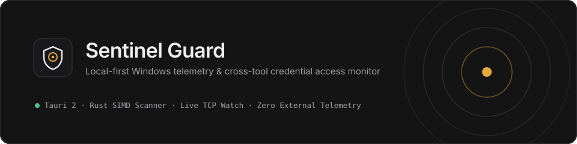

<div align="center">



<h1>Sentinel Guard</h1>

<p><strong>Local-first Windows desktop monitor for hidden telemetry and cross-tool credential access</strong></p>

<p>
  <a href="https://github.com/Sunwood-ai-labs/sentinel-guard/actions/workflows/ci.yml"></a>
  <a href="https://sunwood-ai-labs.github.io/sentinel-guard/"></a>
  <a href="LICENSE"></a>
  
  
</p>

<p>
  <strong>English</strong> · <a href="README.ja.md">日本語</a> · <a href="https://sunwood-ai-labs.github.io/sentinel-guard/">Documentation</a>
</p>

</div>

---

## ✨ Overview

**Sentinel Guard** is a lightweight Windows desktop application built with **Tauri 2, Rust, and React** that inspects installed Electron apps and developer tools for:

- **Hidden telemetry endpoints** (PostHog, Axiom OTLP, Sentry, Segment, Mixpanel, Amplitude, Datadog, `ingest.*`, `telemetry.*`)
- **Cross-tool credential file references** (apps reading other tools' auth files such as `~/.codex/auth.json`, `~/.claude.json`, `~/.aws/credentials`, or `~/.ssh/id_*`)
- **Undocumented opt-out environment variables** (`*_TELEMETRY_ENABLED`, `*_OTEL_SDK_DISABLED`, `DO_NOT_TRACK`, etc.)
- **Live outbound telemetry connections** matched by process name and PID without requiring administrator privileges

All fonts (`IBM Plex Sans JP` / `IBM Plex Mono`) and visual assets are bundled locally—Sentinel Guard makes **zero external CDN or analytics requests**.

## 🔍 Key Features

- **Fast Rust Static Scanner**: Uses SIMD literal-anchor matching (`regex::bytes`) to scan large Electron `.asar` bundles (275 MB+ in ~0.4s) under `%LOCALAPPDATA%\Programs` or any custom folder.
- **Exposure Profile Meter**: Visualizes each app's risk score (`0–100`) with a 20-segment gauge and a 3-axis breakdown (cross-tool credential refs, unblocked endpoints, opt-out env status).
- **Live Network Monitor**: Correlates active `Established` HTTPS/OTLP TCP connections (`Get-NetTCPConnection`) against known telemetry IP maps and inspects Windows DNS cache history.
- **One-Click Mitigations**:
  - Permanently apply or remove user opt-out environment variables (`HKCU\Environment`)
  - Block detected telemetry domains via Windows `hosts` with UAC elevation and automatic DNS cache flush
- **System Tray Resident**: Minimizes cleanly to the Windows tray with a frameless Graphite custom titlebar.

## 🏗️ Architecture

```text
sentinel-guard/
├── src/                        # React 19 + TypeScript + Vite UI
│   ├── App.tsx                 # Dashboard, Exposure Profile meter, Live Monitor
│   ├── App.css                 # Graphite design system & custom titlebar
│   └── assets/                 # Locally bundled background artwork
├── src-tauri/                  # Tauri 2 + Rust backend
│   └── src/
│       ├── scanner.rs          # High-speed .asar / JS static scanner
│       ├── monitor.rs          # Active TCP telemetry matcher & sensitive file watch
│       ├── guard.rs            # HKCU env opt-out & UAC-elevated hosts blocker
│       ├── models.rs           # Shared IPC structs
│       └── lib.rs              # Tauri commands & system tray setup
├── docs/                       # Bilingual VitePress documentation (EN / JA)
└── test-fixtures/              # Portable mock apps (HIGH / MEDIUM / CLEAN) & live probes
```

## 🚀 Quick Start

### Prerequisites (Windows)

- Node.js 20+
- Rust 1.85+ (`cargo`)
- Microsoft Edge WebView2 Runtime (preinstalled on Windows 11)

### Run in Development Mode

```powershell
git clone https://github.com/Sunwood-ai-labs/sentinel-guard.git
cd sentinel-guard
npm install
npm run tauri dev
```

### Build Production Installer

```powershell
npm run tauri build
```

## 🧪 Testing

Run the portable static scanner test suite (uses `test-fixtures/`, runs in CI on any machine):

```powershell
cd src-tauri
cargo test -- --nocapture
```

Run local machine and live TCP probe tests (explicitly gated with `#[ignore]`):

```powershell
cd src-tauri
cargo test -- --ignored --nocapture
```

## 🗺️ Roadmap

- [x] **Phase 1 (MVP)**: High-speed `.asar` / JS static scanner, Exposure Profile UI, live TCP telemetry matching, one-click env opt-out & `hosts` blocking, tray resident mode
- [ ] **Phase 2**: Windows ETW (`Microsoft-Windows-Kernel-File` / `DNS-Client`) helper service for real-time cross-tool file read alerts and desktop notifications
- [ ] **Phase 3**: Automatic scanning for global npm CLIs / MCP servers and Windows Firewall rule management

## 📄 License

[MIT License](LICENSE) — Copyright (c) 2026 Sunwood AI Labs.  
UI refinement methodology credit: *unslop* by Damir Sokolovsky ([@heydamir](https://x.com/heydamir)), CC BY 4.0.
